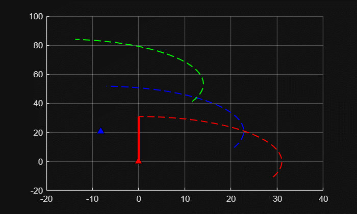
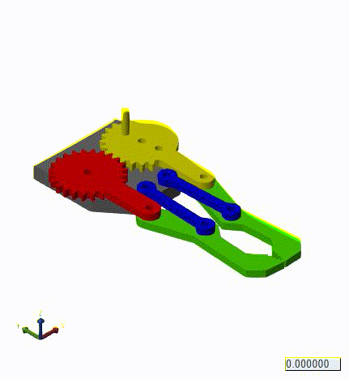

# Media

Store project images, GIFs, and concise clips here. Use descriptive filenames and captions; link to externally hosted videos from this README or a project page. Avoid duplicate or unnecessarily large exports.

## Files

| File | Description | Source |
|---|---|---|
| `Symbolic.gif` | Mechanism path and animation of the right-side linkage (links, joints A, B and tip G) | MATLAB Symbolic Math Toolbox |
| `gripper.gif` | 3D motion of the gear-driven gripper (gears, support links, jaws) | MATLAB Simscape Multibody |

## Previews

### Symbolic kinematics animation

*Figure 1: Trajectory of joints A (red), B (blue) and gripper tip G (green) over θ₁ = −20° to 90°.*

### Simscape Multibody animation

*Figure 2: 3D model with Gear right (yellow), Gear left (red), support links (blue) and jaws (green).*

